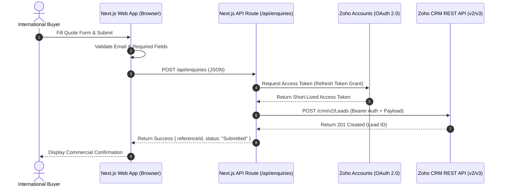

# Zoho CRM & Zoho Forms Integration Architecture
## TOGS Exports B2B Manufacturing Website Concept — By Lumer Labs

---

### Executive Overview

During requirements gathering, **TOGS Exports** identified the need for Zoho tools and ecosystem integration to support international buyer lead generation and commercial customer relationship management.

This document outlines how the front-end inquiry architecture implemented in this concept seamlessly and securely connects to **Zoho CRM (Leads & Deals modules)** and **Zoho Forms** in a production deployment.

> [!IMPORTANT]
> **Security & Authenticity Notice**
> No live credentials or API secrets have been stored in client-side code. The demonstration form in this concept executes client-side schema validation and constructs an authentic, typed Zoho CRM API v2/v3 payload without dispatching fake records. A live connection requires client-authorized OAuth credentials, testing, and production authorization from TOGS Exports.

---

### 1. Data Schema Mapping (Web Enquiry to Zoho CRM)

Our data structure in `src/types/enquiry.ts` and `src/lib/zohoAdapter.ts` maps web inquiry fields directly to Zoho CRM's standard and custom lead fields:

| Website Field | Zoho CRM Module | Zoho API Field Name | Data Type | Notes |
| :--- | :--- | :--- | :--- | :--- |
| **Full Name** | Leads | `First_Name` & `Last_Name` | Text | Split automatically by adapter; `Last_Name` is mandatory in Zoho. |
| **Company Name** | Leads | `Company` | Text | Mandatory field in Zoho CRM. |
| **Business Email** | Leads | `Email` | Email | Validated against corporate email regex. |
| **Phone Number** | Leads | `Phone` | Text | Formatted with international dialing codes. |
| **Country** | Leads | `Country` | Text | Used for international territory assignment rules in Zoho. |
| **Product / Service** | Leads | `Product_Category_Interest` | Picklist | Custom custom field matching catalogue categories. |
| **Estimated Quantity**| Leads | `Estimated_Order_Volume` | Text | Volume indicator for commercial lead scoring. |
| **Specifications** | Leads | `Description` / `Technical_Specs` | Long Text | Detailed dimensional and alloy requirements. |
| **Lead Source** | Leads | `Lead_Source` | Text | Tagged as `"TOGS Exports Website Portal"`. |
| **Lead Status** | Leads | `Status` | Text | Set to `"New_Inquiry"` for automated workflow assignment. |

---

### 2. Integration Implementation Approaches

Depending on TOGS Exports' IT infrastructure, two secure integration pathways are available:

#### Option A: Server-Side API Integration (Next.js App Router / Node.js) — Recommended for Custom Web Apps

In this architecture, web inquiries are sent to a secure internal route handler (e.g. `POST /api/enquiries`), which handles Zoho OAuth2 token refresh and communicates directly with Zoho's REST API.

#### Option B: Zoho Webhook / Zoho Flow Endpoint — Zero Maintenance

If TOGS Exports utilizes **Zoho Flow** or **Zoho CRM Webhooks**:
1. Create a Zoho Flow webhook trigger configured with a shared HMAC secret.
2. The website's serverless route dispatches the payload to the Zoho Flow URL with signature verification.
3. Zoho Flow automatically creates the lead, triggers notification emails to regional sales desks, and assigns tasks in Zoho Projects.

#### Option C: Native Zoho Forms Embed / Web-to-Lead Form (for WordPress)

If the website is implemented in WordPress:
1. Generate an official **Zoho CRM Web-to-Lead Form** or **Zoho Forms** embed code.
2. Style the form using the clean Tailwind CSS design system created in this project.
3. Submissions pass directly to Zoho's secure ingestion gateway with built-in CAPTCHA and anti-spam verification.

---

### 3. Step-by-Step Production Setup Checklist

To activate live Zoho CRM integration with TOGS Exports:

1. **Register API Client in Zoho Developer Console:**
   - Go to [Zoho Developer Console](https://api-console.zoho.com/).
   - Create a **Server-based Application**.
   - Note down `Client ID` and `Client Secret`.
   - Configure Authorized Redirect URI (e.g., `https://togs-exports.com/api/auth/zoho/callback`).

2. **Generate Initial Refresh Token:**
   - Scope required: `ZohoCRM.modules.leads.CREATE,ZohoCRM.modules.leads.READ`.
   - Generate an authorization code and exchange for a permanent `ZOHO_REFRESH_TOKEN`.

3. **Configure Environment Variables:**
   - Copy `.env.example` to `.env.local` or host secret manager.
   - Populate `ZOHO_CLIENT_ID`, `ZOHO_CLIENT_SECRET`, `ZOHO_REFRESH_TOKEN`, and `ZOHO_ORG_ID`.

4. **Test in Sandbox Environment:**
   - Submit test quotation requests using sandbox credentials.
   - Verify lead assignment, custom fields, and email notifications in Zoho CRM.
